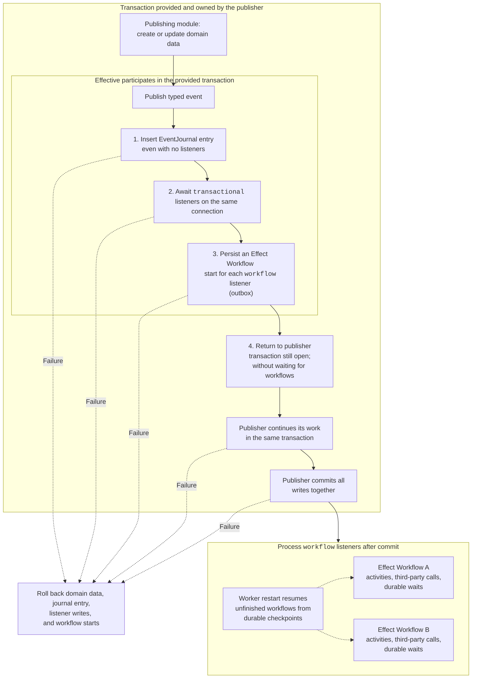

# Effective

Effective is a TypeScript library built on Effect v4 for capability modules, application-service contracts,
and durable domain events. Its npm package name is `@mtdn.dev/effective`.

The package builds ESM JavaScript and TypeScript declarations with tsdown. Effect is a peer dependency; it is not
bundled. Node.js 22.14+ is the supported baseline. CommonJS output is not included.

## Installation

Once the first release is published:

```sh
npm install @mtdn.dev/effective effect@~4.1.2
```

Import module and service helpers from `@mtdn.dev/effective`. For events, create one shared
`createEventSystem({ database: Database, transaction: Transaction })` binding using your application's service
keys, then use its `defineEvent` and `defineListener` functions. Both keys must carry the same database service
shape. Your real transaction wrapper supplies both keys with the transaction connection. See the
[API examples](./ai-docs/api.md) for a complete binding.

Optional PostgreSQL Drizzle read models are exported from `@mtdn.dev/effective/storage`; install `drizzle-orm`
when using that entry point. Effect owns these tables and their migrations.

## Agent skill

The `effective` skill is a small pointer to
`node_modules/@mtdn.dev/effective/AGENTS.md`. Detailed guidance and examples ship in the npm package as
`AGENTS.md` and `ai-docs/`, so agents use the instructions for the installed library version. This follows
[Effect's skill pattern](https://github.com/Effect-TS/skills/blob/main/skills/effect-ts/SKILL.md).

Install the skill from this repository once it is available on GitHub:

```sh
npx skills@1.7.3 add mattddean/effective
```

Or install the same pointer from the npm dependency after the first release:

```sh
npx skills@1.7.3 add ./node_modules/@mtdn.dev/effective
```

The CLI prompts for target agents and installation location. The skill reads the installed package's guidance
each time it is used; upgrading the npm dependency updates that guidance without reinstalling the skill.
In monorepos, use the package installation resolved by the workspace being changed. The package has no
postinstall hook that edits agent configuration.

## Development and publishing

Use Node.js 24, npm 12.2.2, and Bun 1.4.4 for the repository tooling:

```sh
npm ci
npm run check
```

The checks type-check sources, run standalone tests, build with tsdown, run publint, and install a real tarball in
a temporary consumer. They verify ESM imports, optional storage, and the TypeScript examples shipped in the package.
`npm run dev` watches the build. Bun is a development/test dependency, not a requirement for package consumers.

The [publishing guide](https://github.com/mattddean/effective/blob/main/docs/publishing.md) covers first-release
bootstrap, trusted publishing setup, and tag-triggered releases. The pointer skill is distributed from this repository or the npm package;
its detailed guidance is versioned with each npm release.

The library and its bundled skill are licensed under the [MIT License](./LICENSE).

Backward compatibility is not required. Prefer clean breaks when evolving framework APIs: update all callers,
documentation, and tests together, and remove obsolete APIs rather than adding compatibility shims or deprecated aliases.

## Architectural basis

Effective uses NestJS's module ownership model as a design reference and Effect's typed layers for dependency
composition. These are architectural references, not dependencies on NestJS or its decorator-based container.

- [NestJS modules](https://docs.nestjs.com/modules) define provider ownership and visibility: local providers are
  encapsulated, imports expose another module's exports, and exports form the public interface. Registering a
  provider in a root module does not automatically make it global.
- [NestJS's Nest Commander recipe](https://docs.nestjs.com/recipes/nest-commander) registers commands as injectable
  module providers. Its [standalone application model](https://docs.nestjs.com/standalone-applications) reuses the
  module graph without starting an HTTP listener. Nest Commander is a third-party integration documented by NestJS.
- [Effect v4 layers](https://effect.website/docs/v4/requirements-management/layers) express construction dependencies
  and errors in types. `Layer.provide` connects dependencies; merging layers combines their outputs without wiring
  dependencies between siblings. [Layer memoization](https://effect.website/docs/v4/requirements-management/layer-memoization)
  shares stable layer instances within a construction graph; Effect scopes manage resource lifetime.

For version-specific details, consult the documentation and source shipped with the installed Effect version.
`Command.provide` accepts either a layer or a function that selects a layer from parsed command input.

A module declares its providers once, and its services and commands consume that same dependency graph.
Effective also requires resource-free help, preservation of transaction connections, and explicit event activation.

## Application services

[`defineServiceLayer`](https://github.com/mattddean/effective/blob/main/src/service.logic.ts) constructs an application service's layer:

```ts
static readonly layer = defineServiceLayer(PostsService, { make: makePosts })
```

The service's Effect methods must have no unresolved service requirements. If a method publishes an event without
supplying its transaction, the diagnostic appears at this declaration and identifies the offending method, instead
of surfacing later at the HTTP handler. Arguments, success types, error types, and value properties remain inferred.

The service factory can still require process dependencies; those requirements and construction errors remain on
the layer. Repositories use `Layer.effect` directly because their methods intentionally retain the database service so they
can participate in the caller's transaction.

## Capability modules

[`defineModule`](https://github.com/mattddean/effective/blob/main/src/module.logic.ts) composes a capability into an ordinary Effect layer:

| Field       | Purpose                                                                 |
| ----------- | ----------------------------------------------------------------------- |
| `imports`   | Supply dependencies from other capabilities.                            |
| `internal`  | Supply private dependencies, including repository layers.               |
| `exports`   | Define the public services exposed by the module.                       |
| `events`    | Declare the event contracts owned by the module.                        |
| `listeners` | Acquire scoped event subscriptions without exposing their dependencies. |
| `commands`  | Register Effect factories for the capability's CLI command groups.      |

Only `exports` appear in the module's public context. Infrastructure requirements and construction errors remain
for the runtime root to handle. Sibling layers need explicit `Layer.provide` wiring; listing them together does not
connect them. Keep shared layer values stable so Effect memoization can share their acquisition and lifetime.

### CLI commands

#### Registration

Each capability owns its command groups and subcommands in `.command.ts` files and registers their factories in
its `.module.ts` definition:

```ts
export const IdentityModule = defineModule({
  imports: [],
  internal: [AccountRepository.layer],
  exports: [AccountsService.layer, AuthorizationService.layer],
  commands: [makeUsersCommand],
})
```

Every `make…Command` is an Effect producing an Effect CLI `Command`. Use `Effect.succeed` for groups without
construction dependencies and `Effect.gen` to resolve resource-free configuration or layer factories. Constructing
a command tree must not acquire connections, perform application I/O, or run handlers: construction also runs for
help and completion.

`defineModules` collects the explicitly registered modules' command factories in `.commands`. It does not collect
commands recursively from imports, which would duplicate shared capabilities. The CLI runs
`Effect.all(ApplicationLayer.commands)` and passes the resulting groups to `Command.withSubcommands`.
Keep the command tree separate from the executable entry point so tests can exercise the same registration
and parsing without starting a process.

#### Module dependencies

Commands consume their owning module's declared providers. The framework supplies these dependencies when the
selected handler executes, preserving Effect's explicit wiring and type inference:

| Declaration | Command visibility                                                                           |
| ----------- | -------------------------------------------------------------------------------------------- |
| `imports`   | Public services exported by the imported capabilities.                                       |
| `internal`  | Private providers available within the owning module, including its commands.                |
| `exports`   | The module's public service implementations, also usable by its own commands.                |
| `commands`  | Module-owned command groups whose dependencies are satisfied through the declarations above. |

Only `exports` cross the public module boundary. Making a private repository available to an owning command must
not export it into the application context or make it available to commands in other modules. Cross-module work
uses the other module's public application services. Declare explicit wiring between sibling layers once in the
module's layer composition and reuse it for services and commands.

For example, a password command requires `AccountRepository`; its owning module declares
`internal: [AccountRepository.layer]`. The framework supplies that repository to the command. The handler retains
its typed requirements, and the command and executable do not repeat the repository layer declaration.

#### Ownership, configuration, and lifetime

Treat these as separate decisions:

- **Ownership:** capability modules declare their providers and imported interfaces. Infrastructure providers can
  be composed through infrastructure layers or modules, with explicit requirements wherever they are consumed.
- **Configuration:** the process composition selects deployed implementations and supplies environment settings.
  Values from CLI arguments configure the selected execution. Where a value becomes available
  does not change which module owns the consumer or which providers it may access.
- **Lifetime:** Effect layers and scopes acquire, share, and release resources. A command can use
  `Command.provide(input => layer)` to bind parsed configuration at execution time. The framework must preserve
  that scope and shared layer identities when supplying module dependencies.

The application's runtime entry point selects its module composition, supplies remaining process requirements,
and runs the CLI with platform services and observability. It must not enumerate individual command groups or
duplicate module-private provider wiring. Adding a command changes its owning module; adding a capability or
changing deployment configuration can change the application composition.

Declare deployment layers at the process composition root. When a command selects infrastructure through parsed
arguments, bind its unbuilt layer with `Command.provide(input => layer)`. Keep those options on the commands that
use them. Parent groups assemble subcommands without knowing their infrastructure configuration. Construction
and help must not build the selected layer.

Dependency visibility and feature activation must remain distinct. Help, completion, and invalid arguments must
not acquire application resources. Executing a command must not unintentionally start HTTP servers or workflow
workers. A command that publishes domain events still needs the appropriate journal and listener composition;
omitting listeners to simplify CLI startup must not silently change mutation semantics. Commands that only trigger
workflows use a client-only workflow engine. These lifecycle rules must be tested alongside dependency composition.
`defineModules` activates the declared application graph during command execution, including all of its listeners.
This activation keeps service outputs hidden; each command receives only its own module's declared providers.

#### Testing

Framework tests must verify that:

1. A command receives its module's private and public providers and imported public services without re-providing them.
2. Private providers remain absent from public layer outputs and unavailable across module boundaries.
3. Unsatisfied requirements and construction/handler errors remain in the inferred types.
4. Shared layer instances are acquired once per execution scope and released on success, failure, and interruption.
5. Help, completion, and invalid input acquire no application resources; selected execution activates only its intended runtime features.
6. Test providers replace production infrastructure while repository calls retain the ambient transaction connection.

Run database-backed command tests through a test runtime with the module's registered command tree. The test
runtime supplies infrastructure and can replace input-dependent providers. Do not import an executable entry
point or provide production layers in those tests. Keep registration, dependency visibility, type inference, and
lifecycle coverage in [`module-commands.test.ts`](https://github.com/mattddean/effective/blob/main/test/unit/module-commands.test.ts).

## Durable domain events

The `defineEvent` function returned by `createEventSystem` defines a typed domain fact in the publishing capability's `.event.ts` contract.
Consuming capabilities own `.listener.ts` layers built with the same binding’s `defineListener`. Register these layers in the owning
module's `listeners` array; publishers remain independent of their consumers.

Declare owned event contracts in the publishing module:

```ts
defineModule({
  imports: [IdentityModule],
  internal: [PostRepository.layer],
  exports: [PostsService.layer],
  events: [PostCreated, CommentCreated, ReactionCreated],
})
```

Compose the application's owning modules with `defineModules([PostsModule, NotificationsModule, ...])`.
TypeScript rejects duplicate event names within a module and across that composition, even when the payload
schemas are identical. Event and module lists must remain inferred tuples so their names can be checked.
Consumers import the publisher's shared event layers; referencing an event does not declare ownership.
Stable layers share their channels through Effect's normal memoization. There is no runtime name registry.



`publish` uses the supplied transaction and returns before it commits. The publisher can continue writing, then
commit or roll back all writes together. Workflow implementations own their database transaction boundaries;
the publisher's transaction ends at commit.
One workflow's failure cannot roll back publication or stop another consumer. Each journal entry and listener has
its own workflow execution identity, while the journal remains an independent history of committed facts.

Each listener declares `processing: 'transactional'` or `processing: 'workflow'`. Both modes can consume the same event.
Transactional listeners use `make` to capture process dependencies and construct an inline handler. They keep their
database requirements so publication supplies the publisher's connection.

Workflow listeners reference a native `.workflow-contract.ts` definition and map the event into its typed payload:

```ts
defineListener(CommentCreated, {
  name: 'notifications.created-comment',
  processing: 'workflow',
  workflow: CommentNotificationWorkflow,
  mapPayload: (event) => ({
    commentEventId: event.commentId,
    commenterId: event.authorId,
    organizationId: event.organizationId,
    postId: event.postId,
    teamId: event.teamId,
  }),
})
```

Register the workflow's `.workflow.ts` implementation on the worker through its normal `toLayer` composition.
Effective persists the supplied workflow's start directly. There are no generated listener workflows and no listener
`discard` option: publication always schedules with `discard: true`. To wait for completion, call the workflow directly
with `discard: false` outside the publishing transaction.

Payload encoding and result decoding schemas must not require additional services. Deliveries use a stable hash of the
workflow name, event name, listener name, and journal entry ID. This overrides the workflow's business idempotency key:
separate events and separate listeners remain independent even when they share a contract with a constant key.
Consumers that need business-level deduplication should also use stable domain identifiers.

Workflow handlers execute independently after commit and own their database transaction boundaries. The engine never
wraps workflow execution in a transaction. Keep third-party calls and durable waits outside explicit database transactions.

`publish(payload)` requires the transaction service. Inside the application's transaction boundary it:

1. Encodes the typed payload and inserts a native EventJournal entry, even with no listeners.
2. Awaits every transactional listener using the publisher's transaction.
3. Persists an independent workflow start record for each async listener.
4. Returns to the transaction owner, which commits all database writes together.

A journal insert failure invokes no handlers. Transactional listener errors, workflow storage failures, and commit
failures roll back the mutation, journal entry, listener database writes, and workflow starts together. Inline external
side effects cannot be undone by database rollback. Typed listener failures become
[`EventListenerError`](https://github.com/mattddean/effective/blob/main/src/event.schema.ts); defects and interruption propagate through the transaction boundary.

Workers process workflow listeners after commit. Publication does not await workflow completion, and execution failure
does not undo publication or prevent other consumers from succeeding. Keep workflow, event, and listener names stable
across publisher and worker deployments. Unfinished jobs recover on worker restart; completed deliveries retain native
workflow deduplication until workflow storage is cleared. Journal history survives that cleanup independently.

Event concurrency defaults to `unbounded`; `1` runs sequentially. The limit applies separately to transactional handlers
and async scheduling, with the entire transactional phase finishing before workflow scheduling begins. Each publication snapshots
the current subscriptions; scoped layers unregister when disposed.

Modules supply their owned event channels; consumers import the shared event layers. Compose
[`EventJournalLive`](https://github.com/mattddean/effective/blob/main/src/event-journal.layer.ts) at the runtime root. Supply the same
SQL client layer used by the database service and workflow storage so ambient SQL transactions span all three. Build the owning
module layers on workers too. Client-only publishers register workflow
contracts without executing the jobs locally.

Effect's `SqlEventJournal` creates and owns `effect_event_journal` and its sequence, source, checkpoint, and cursor
metadata tables. Effect cluster storage owns
the workflow tables. [`event-journal.schema.ts`](https://github.com/mattddean/effective/blob/main/src/event-journal.schema.ts) and
[`workflow-storage.schema.ts`](https://github.com/mattddean/effective/blob/main/src/workflow-storage.schema.ts) describe these tables for reading; they are not application
migration inputs. Check the installed Effect version's storage behavior and table definitions when upgrading.

## Verification

The maintained suite in [test/unit](https://github.com/mattddean/effective/tree/main/test/unit) covers:

- Module visibility, explicit sibling wiring, shared acquisition, and resource lifetime.
- CLI registration, private dependencies, parsed configuration, and resource-free help/completion.
- Compile-time duplicate event-name rejection and valid consumer reuse.
- Real SQLite journal publication and listener writes, commit/rollback, and scoped subscription disposal.

PostgreSQL deployment compatibility and persistent worker restart recovery are not covered by the current suite.
