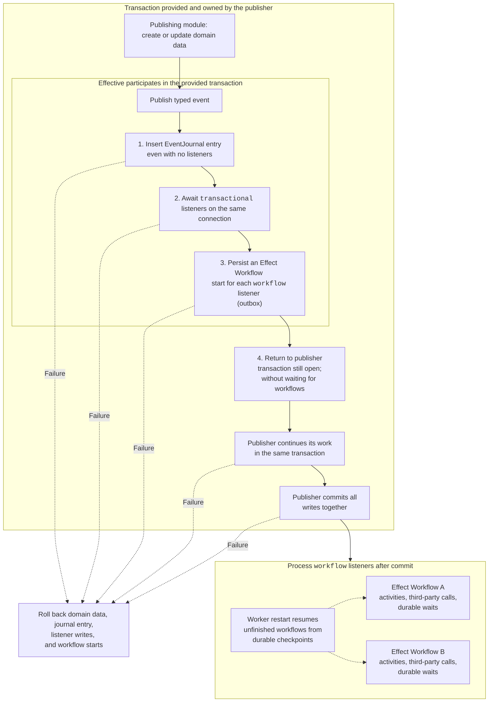

# Effective

Effective is a lightweight framework for Effect V4 that makes you incredibly effective at building large, modularized applications. It's inspired by NestJS modules and "modular monolith" patterns.

## Installation

```sh
npm install @mtdn.dev/effective effect
```

If you're writing with agents, add the skill:

```sh
npx skills@1.7.3 add mattddean/effective
```

Then execute the skill to give your agent context about how effective works.

## Modules

`defineModule` composes a capability into an ordinary Effect layer:

| Field       | Purpose                                                                 |
| ----------- | ----------------------------------------------------------------------- |
| `imports`   | Supply dependencies from other capabilities.                            |
| `internal`  | Supply private dependencies, including repository layers.               |
| `exports`   | Define the public services exposed by the module.                       |
| `events`    | Declare the event contracts owned by the module.                        |
| `listeners` | Acquire scoped event subscriptions without exposing their dependencies. |
| `commands`  | Register Effect factories for the capability's CLI command groups.      |

## Durable domain events

You can define an event and then listen to it with two kinds of listeners. The publisher doesn't care how its listeners want to listen (although a future iteration should provide a way to create a type of event that is only listenable via one of the other):
- `transactional`: A listener can be transactional, simply meaning that it participates in the transaction of the publisher. At compile time, we require that a transaction is provided via DI. E.g. emitAsync from NestJS.
- `workflow`: Or a listener can be a workflow, meaning that it does not participate in the transaction and can have multiple steps (Activity.make's).

Events are durably stored in a table, using Effect's `SqlEventJournal`, even if they have no listeners or all their listeners are `transactional`.

Naturally supports resuming workflows if a process dies. That's just how Effect Workflow works.



## CLI commands

Each capability owns its command groups and subcommands in `.command.ts` files and registers their factories in its `.module.ts` definition.

## Database schemas

Effect automatically create tables in your database when you use the folloiwng layers:

| Tables | Created by |
| --- | --- |
| `cluster_messages`, `cluster_replies` | `SqlMessageStorage.layer` |
| `cluster_runners` | `SqlRunnerStorage.layer` |
| `effect_event_journal` | `SqlEventJournal.layer()` |
| `effect_event_journal_sequence` | `SqlEventJournal.layer()` |
| `effect_event_journal_sources` | `SqlEventJournal.layer()` |
| `effect_event_remotes_checkpoints` | `SqlEventJournal.layer()` |
| `effect_event_remotes_cursors` | `SqlEventJournal.layer()` |

But their schemas are not published by Effect. It can be useful to get access to those schemas, so Effective provides them to you through `@mtdn.dev/effective/storage/drizzle`. Currently only Drizzle/Postgres tables are provided:

```ts
import { clusterMessages, eventJournal } from '@mtdn.dev/effective/storage/drizzle'
```
